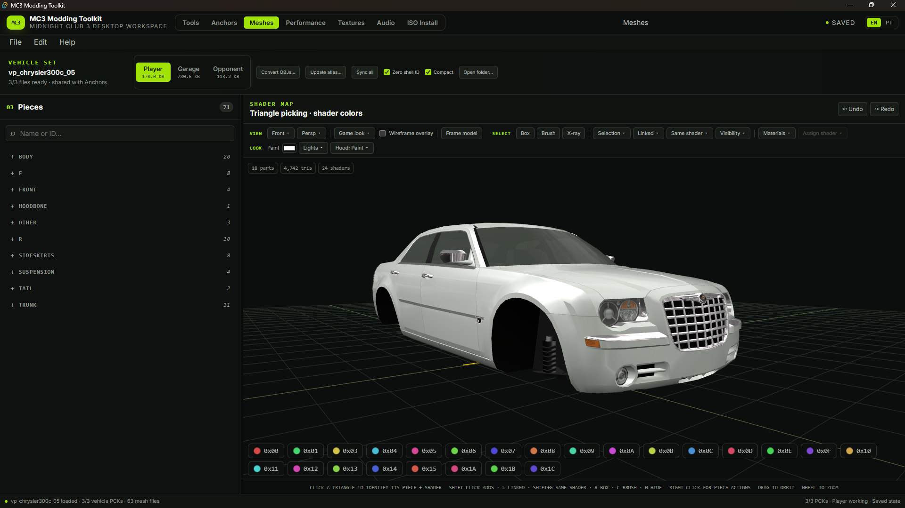
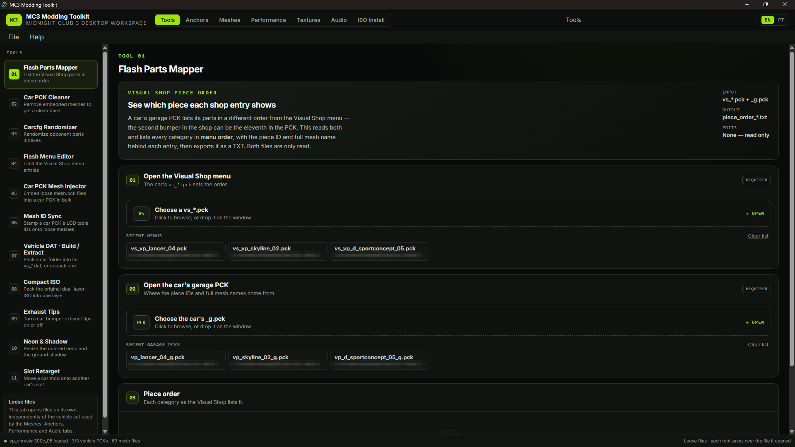
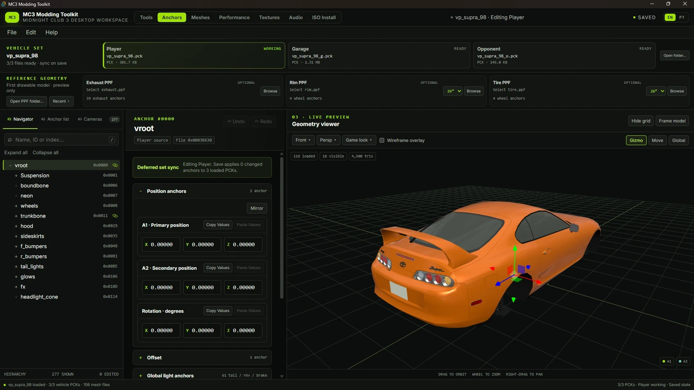
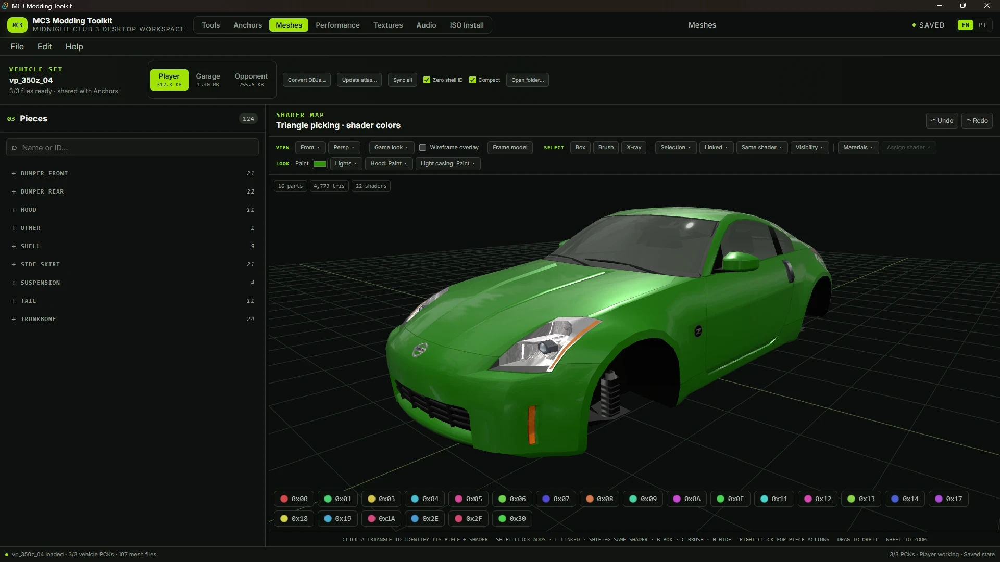
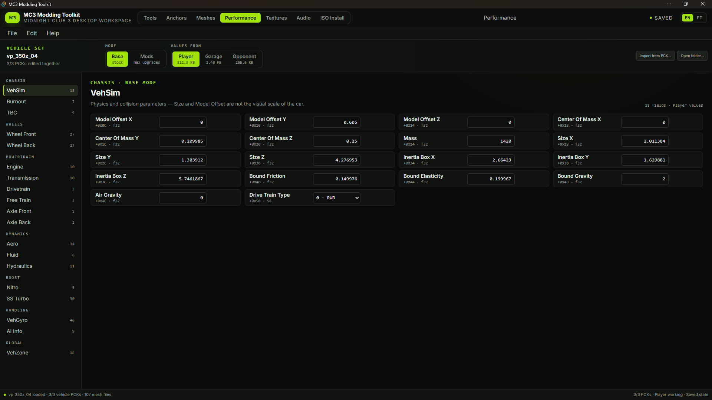
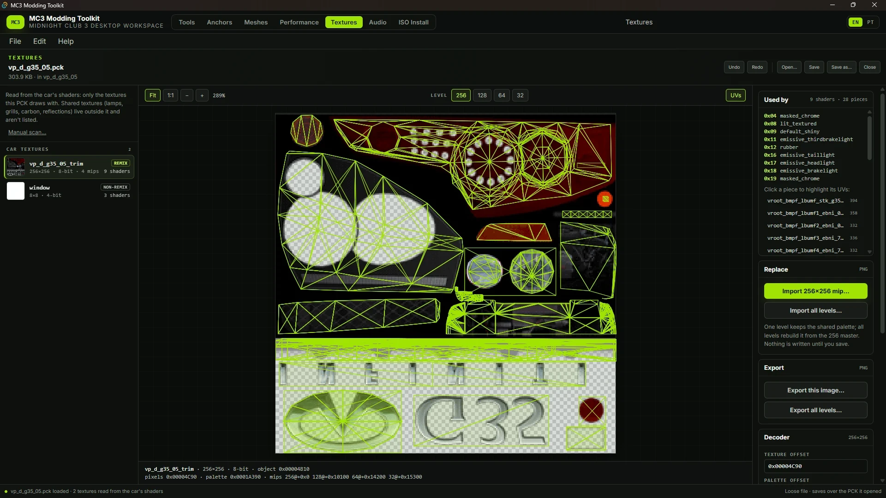
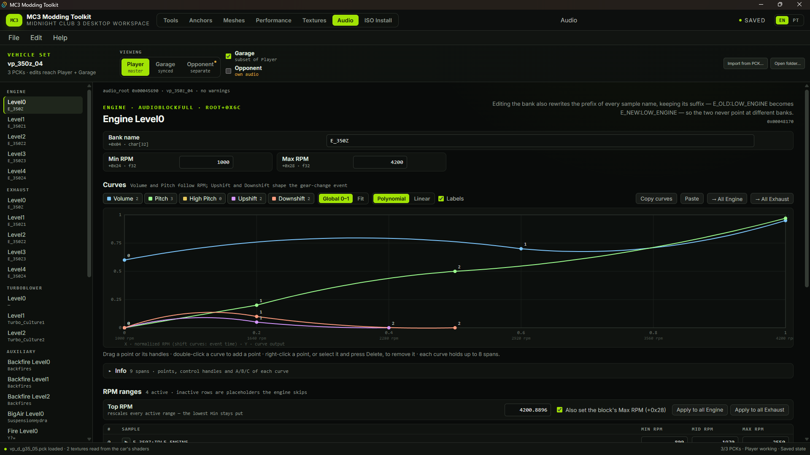
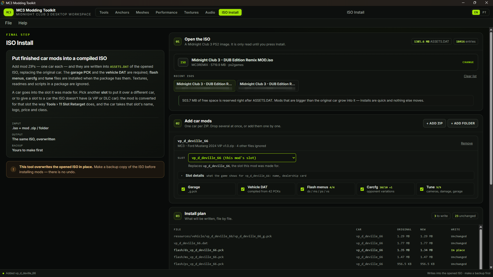

# MC3 Modding Toolkit

Offline desktop workspace for Midnight Club 3: DUB Edition Remix car mods, built with Tauri. It
works on a vehicle as a whole: the Player, Garage (`_g`) and Opponent (`_o`) PCKs plus the loose
`mesh.pck` files that sit beside them. The interface is available in English and Portuguese.

> **Fan-made tool.** Not affiliated with or endorsed by Rockstar Games or Take-Two Interactive.
> Midnight Club is their trademark. This repository contains no game files: you need your own copy
> of the game to use it.



## Download

Get the latest build from the **Releases** page. There are two:

- **`MC3 Modding Toolkit.exe`** (about 10 MB): for almost everyone. Windows 11 and current
  Windows 10 already have the WebView2 runtime it needs. Download and run it, nothing is installed.
- **`MC3 Modding Toolkit <version> (portable).zip`** (about 360 MB): only if the exe opens an error
  saying it "Could not find the WebView2 Runtime" (Windows Server, LTSC, N editions, debloated
  installs). Extract it to a short path such as `C:\MC3ModTool` and run the exe inside. Keep the
  `wv2` folder next to the exe.

Use **Open vehicle folder** and select the directory holding the three car PCKs to have the roles
discovered automatically; missing roles stay available as manual file slots. The folder can also be
dropped onto the window. Keep a backup of your files anyway.

## Tabs

| Tab | What it does |
| --- | --- |
| **Tools** | Loose-file tools: Visual Shop menu editor, Carcfg Randomizer, Flash Parts Mapper, Car PCK Mesh Injector, Mesh ID Sync, Car PCK Cleaner, Vehicle DAT (build / extract), Compact ISO, Exhaust Tips, Neon & Shadow and Slot Retarget |
| **Anchors** | Anchor positions and rotations with a 3D preview and move/rotate gizmo, multi-select, mirroring and wheel/exhaust sync, plus the garage shop cameras |
| **Meshes** | Triangle selection and moving triangles to another shader, piece IDs, shader IDs, OBJ conversion (compact by default), re-embedding loose `mesh.pck` files, removing an embedded copy, and OBJ export |
| **Performance** | Vehicle physics and performance values across all three PCKs at once |
| **Textures** | Reads a car PCK's textures through its shaders (with the pieces and UVs that use each), previews, exports and replaces them; the scored scan stays as a fallback |
| **Audio** | Engine audio curves and values, with an audible preview from the game's sound banks; RPM ranges rescale to a new top RPM, and curves copy across levels |
| **ISO Install** | Installs the finished cars straight into the game's ISO, into the slot each was made for or any other; can rename the slot and change its dealership card, icon and special ability |



## Reporting a problem

If the tool shows something it shouldn't (a car opening without its shell, say), open the car the
way you usually do and use **Help ▸ Save diagnostic report…**. It saves a text file listing what the
tool read, decided and drew, your graphics card and the errors since it opened: file names, sizes
and hashes, never file contents, with your user folder masked. Send that file along with the report.
**Help ▸ Compare diagnostic reports…** lists the rows that differ between two of them, such as one
from the computer with the problem and one made elsewhere with the same files.

## Credits

Built on the community's investigation of the game's files: Bruno (@offlbruno) and ZNX (@znxee)
for the research and base code behind the PCK format; @ZNXee171 and @mc3rxx (Performance Editor);
EdnessP (`dave.py`); RibeiroG (MC3 ISO Direct Explorer). Special thanks to Almightypear, Rato.jpg and
RibeiroG. Toolkit, Audio Curve GUI, Texture Finder and the carcfg / flash menu / injector / ID fix
scripts by [@mid_engine](https://youtube.com/@mid_engine). The full list is in
**Help ▸ About**.

## How it edits

**Everything is edited in memory. Nothing is written to disk until you explicitly save.** Opening,
editing, undoing and switching between tabs never touch a file; the only writes in the whole
application happen inside the save action, and every destination is read back and byte-compared
before the document is marked as saved.

## Exporting the car

**File ▸ Export ▸ OBJ…** or **GLB…** writes the whole car to one file: every high-LOD piece the
Anchors view draws (no MLOD/LLOD copies, no ground shadow), pending edits included, each piece its
own object placed by its anchor. Materials come one per shader ID, named the way **Convert OBJs**
reads them back (`05 - carpaint`), with the Game look's colors and the car's textures.

- **GLB**: one file with the textures inside. Each object's origin sits on its anchor, rotation
  included, and carries its piece ID and anchor as custom properties.
- **OBJ**: an `.mtl` and the textures as PNGs are written next to it. OBJ has no object origins, so
  every object's origin is the world origin.

Every customization variant is exported, stacked in place (all the bumpers, spoilers, hoods…).
Wheels are not included: they live in the shared `rim.ppf` / `tire.ppf`.

## Anchor Editor



- Detects PS2 `0x44` and PSP `0x60` anchor layouts, reading the parent/child/next hierarchy.
- Edits A1 and A2 as little-endian `float32` values, with undo/redo, clipboard actions and
  dedicated `Copy Values` / `Paste Values` controls per anchor.
- Edits each anchor's rotation in degrees (stored as radians), from the Rotation card or the 3D
  gizmo (`R` toggles move/rotate, `Shift` snaps to 15°); Mirror flips position and rotation.
- Supports horizontal value scrubbing in every coordinate field (`Shift` fine, `Ctrl` fast),
  recorded as one undo step per drag.
- Accepts arithmetic in the coordinate fields — `1.5+0.25`, `10-5`, `2*1.5`, `10/4`, parentheses.
  The field already holds its current value, so appending an operation is the usual gesture.
  Nothing is implicit: a bare `*2` is not a relative operation, it just reverts the field, as does
  anything else that isn't a complete expression.
- Sets every taillight glow anchor at once from the **Global light anchors** panel: type the
  left-hand XYZ on the `tail`, `rev` or `brake` row and press its `Set`. The value goes to every
  taillight variant, with X flipped for the right side and the same value in A1 and A2. Each row is
  applied on its own and is its own undo step.
- Mirroring, pasting and dragging across a multi-selection are each a single undo step.
- Multi-selects anchors (`Ctrl`+click to toggle, `Shift`+click for a range) and moves them together
  in the 3D view via a translation gizmo (`Ctrl+G`).
- Offsets a whole selection by a relative step from the **Offset** panel: enter XYZ, press `Move`,
  and every selected anchor advances from its own current position (A1 and A2 alike). The fields
  keep their values, so clicking again steps by the same amount.
- Mirrors the selected anchors across X in one step (`Ctrl+Shift+M`, the `Mirror` button, or
  `Edit ▸ Mirror anchors on X`), recorded as a single undo step.
- Synchronizes changed anchors, plus validated PS2 wheel and exhaust runtime positions, to the
  other loaded roles when saving.
- Previews the car with Three.js, decoding standalone PS2 `mesh.pck` geometry, and can load
  optional `exhaust.ppf`, `rim.ppf` and `tire.ppf` files as reference placeholders with a
  synchronized 13–30 inch rim-size selector. PPFs are never modified.

## Mesh Editor



- Colors the model by shader ID and identifies the piece, material group and shader behind any
  triangle you click.
- **Game look** draws each shader like the game does (the car's own textures, paint, chrome, glass,
  lights), with a paint color you pick; view only. The Anchors viewer has it too.
- The pieces shown at first are the stock car, read from the PCK's own customization lists, so
  ported cars that don't name their parts `stk` open without every variant on top of each other.
- **Update atlas…** replaces the car's atlas with one PNG in Player, Garage and Opponent at once,
  each in the format it already has (256 or 128, with or without mips). Not tested in game yet.
- **Selects triangles** Blender-style: click / Shift-click, linked (L, Ctrl+L, stopping at the
  shader by default), same shader (Shift+G) in this part or all parts, box (B) and brush (C, Shift+wheel
  sizes it), with X-ray, select all / none / invert, and hide / isolate / reveal. Selection steps are
  part of Undo.
- **Assign shader** moves the selected triangles to another shader, picked by name from the car's own
  shader list (carpaint, chrome, carbon_fiber…): into the piece's slot with that shader, or a new slot.
  The piece isn't re-encoded: its packets stay byte for byte, the moved triangles are switched off in
  place and written again in the target slot (~34 bytes each), keeping each vertex's crash-deformation
  data. Moving them back costs nothing. Every copy of the piece is updated: the loose file and the
  embedded copies.
- Edits a piece's **ID**, mirrored across the HLOD/MLOD/LLOD tables, every embedded copy and the
  loose `mesh.pck`.
- Edits a piece's **shader IDs** per material group, written to every loaded PCK that embeds the
  piece and to the loose file. Pending values show amber until saved.
- **Re-embeds** a loose `mesh.pck` into the PCKs that bake it in, handling a piece whose mesh
  changed size, and **inserts** pieces that have a table row but no embedded copy yet. Shell-family
  pieces go into every PCK that has a row for them; customization parts go into the garage PCK
  alone. `Sync all` does both in one pass.
- Re-embedding is idempotent: repeating it reuses the block the piece already occupies instead of
  appending a duplicate, and saving reclaims space left by earlier copies.
- **Converts OBJs** to `mesh.pck`: the piece ID comes from the filename (`4C - name.mesh.obj`) and
  each group's shader ID from its material name (`05 - Carpaint`; also `06`, `06 00`, `0x0006`,
  `shader_0006`, `slot_000_shader_0006`, `bytes_06_00`). Output is byte for byte that of
  `mc3_obj_to_pck.py`, with one deliberate difference: a material name without an explicit ID is
  never guessed from. The Python tool reads hex letters out of ordinary words
  (`M_Opaque_PlasticSmoothBlack_Max` → 0xAC from "Black", `Default` → 0xDE, `Material.001` → 0x0E,
  `Chrome_02` → 0x02) and gives faces before the first `usemtl` shader 0xDE; here those materials
  get the car's carpaint shader (0x03 when none is found) and are listed in a dialog. Every name
  both accept gets the same ID. The same dialog flags any converted shader ID above the highest one
  the car's own pieces use.

## Performance



- Edits the car's physics and performance blocks, grouped as in the game's data: chassis (VehSim,
  burnout, TBC), front and rear wheels, powertrain (engine, transmission, drivetrain, axles),
  dynamics (aero, fluid, hydraulics), boost (nitro, turbo), handling (VehGyro, AI info) and VehZone,
  the values the car uses during the Zone ability.
- **Base** is the stock car and **Mods** the fully upgraded one; VehZone is a single block for both.
- Every edit goes to the Player, Garage and Opponent PCKs at once.
- **Import from PCK…** copies another car's Base, Mods and VehZone, previewed before anything changes.

## Textures



- Opens a car PCK on its own and lists the textures its shaders draw with (the car's atlas, the
  window texture), with the shaders and pieces that use each; click a piece to see its UVs.
- Shows every mip level, exports any of them as PNG, and replaces them from a PNG: one level keeping
  the shared palette, or all levels rebuilt from the 256 master. Nothing is written until you save.
- Shared textures (lamps, grills, carbon, reflections) live outside the car PCK and aren't listed;
  a manual scan stays available for PCKs the shaders don't cover.

## Audio



- Edits the engine, exhaust and turbo blower levels and the auxiliary sounds (backfire, big air,
  fire…): bank names, RPM limits and the volume, pitch, upshift and downshift curves, by dragging
  points and handles.
- Plays the samples from the game's own sound banks, so a change can be heard before saving.
- Rescales every RPM range to a new top RPM, and copies curves to another level or to every engine
  or exhaust level at once.
- Renaming a bank also renames the prefix of its samples, so the two never point at different banks.
- **Import from PCK…** brings in another car's audio. Player and Garage stay in sync; the Opponent
  can be edited on its own.

## ISO Install



- Each car goes into the slot it was made for, or into another slot you pick. A car the ISO doesn't
  have (a VIP or DLC car) has to be given one. Moving a car converts its package the way
  **Tools ▸ 11 Slot Retarget** does, against the opened ISO's own rims, exhausts and text.
- **Slot details** edit what the game shows for that slot: name and short name, the dealership's
  shown price, class letter and type, the icon's brand logo and REMIX badge (from the logos the game
  has; the logo also sets the garage's bottom band), and the slot's real class, which picks its
  special ability (Zone, Agro or Roar). These live in files every car shares, so the edits of all
  the cars in an install are written together. The Mercedes/AMG icons can't be changed yet.
- Not tested: whether the purchase charges the shown price, and career events open to one class only
  after a class change.

## Building

Requires Node.js 22.13.0+, pnpm and the Rust toolchain. A build writes the executable and an NSIS
installer:

```text
src-tauri\target\release\MC3 Modding Toolkit.exe
src-tauri\target\release\bundle\nsis\MC3 Modding Toolkit_<version>_x64-setup.exe
```

If `cargo` is not on the inherited PATH, reload it before building:

```powershell
nvm use 22.13.0
$env:Path = [System.Environment]::GetEnvironmentVariable("Path","User") + ";" + [System.Environment]::GetEnvironmentVariable("Path","Machine")
pnpm typecheck
pnpm tauri build
```

`pnpm dev` runs the app in a dev window with hot reload. Close `MC3 Modding Toolkit.exe` first before a release
build — a running instance locks the output file.

There is no browser mode. The `@tauri-apps/*` packages need the real Tauri runtime, and
`getCurrentWindow()` runs during the first render, so serving `dist/` over plain HTTP gets you a
blank page and a console error rather than a working app.

## Distributing it

The app draws its interface with WebView2 — the whole interface, the 3D viewer and every file
engine run inside it, with Rust doing little more than opening the window. Windows 11 and current
Windows 10 ship WebView2, so `pnpm tauri build` produces a 10 MB exe that runs anywhere on its own.
That is the build to hand out.

Some installs have no WebView2 — Server, LTSC, N editions, debloated images with Edge stripped —
and there a bare exe fails with "Could not find the WebView2 Runtime" before drawing anything. For
those, `pnpm package:portable` builds a second kind that carries its own engine, merging
`src-tauri/tauri.portable.conf.json` over the normal config to set `webviewInstallMode` to
`fixedRuntime`. Nothing about the day-to-day build changes, and there is no flag to remember: the
overlay applies only inside that one script.

The two are not interchangeable. A `fixedRuntime` build **does not** fall back to an installed
WebView2 — with no reachable `wv2` folder beside it, the window opens empty and no renderer starts.
So the portable exe must always travel with its folder, and the ordinary exe must never be shipped
to someone without WebView2.

The runtime folder is **not in the repository** — it is 800 MB. Download the x64 fixed-version
from the [WebView2 download page](https://developer.microsoft.com/en-us/microsoft-edge/webview2/)
(Fixed Version, x64) and expand the `.cab` into `src-tauri/wv2/`, so that
`src-tauri/wv2/msedgewebview2.exe` exists:

```powershell
expand.exe Microsoft.WebView2.FixedVersionRuntime.<version>.x64.cab -F:* src-tauri\_cab
Move-Item src-tauri\_cab\Microsoft.WebView2.FixedVersionRuntime.<version>.x64 src-tauri\wv2
```

Then build the package to send:

```powershell
pnpm package:portable
```

It writes `dist-portable/` — a folder of about 810 MB and a zip of about 360 MB. The recipient
extracts it and runs the exe; nothing is installed and no internet is needed. Before compressing,
the script launches the staged copy and checks that a titled window appears and that the renderer
processes come from the bundled `wv2` — this build is never exercised while developing, so without
that check the first person to find it broken would be whoever downloaded it.

Two things this trades away. Windows no longer updates the browser engine for these builds, so a
security update means downloading a newer runtime and rebuilding. And the runtime is deeply nested,
which matters because Windows caps a path at 260 characters: the package spends 110 of them, so it
can be extracted into a folder path of up to 150. Deeper than that and the loader cannot reach the
runtime — the window opens empty. That is why the folder inside the zip is `MC3ModTool` and the
runtime folder is `wv2`, rather than the app's full name and the runtime's own 56-character one.
Those names buy 48 characters of headroom and cost nothing; the app itself keeps its real name.

## Binary safety

The parser validates the anchor pointer route, entry count, file bounds, names and hierarchy links
before enabling editing. Wheel and exhaust runtime synchronization is enabled only when those
tables pass their own structural checks.

Relocating a mesh piece walks the piece's exact internal pointer graph rather than scanning for
pointer-shaped values, because vertex data can contain values indistinguishable from a valid
address. Pieces that fail any bounds or pointer check are rejected before they can reach a car PCK.
Blocks the game shipped embedded are never overwritten or moved.

## License

[MIT](LICENSE).
